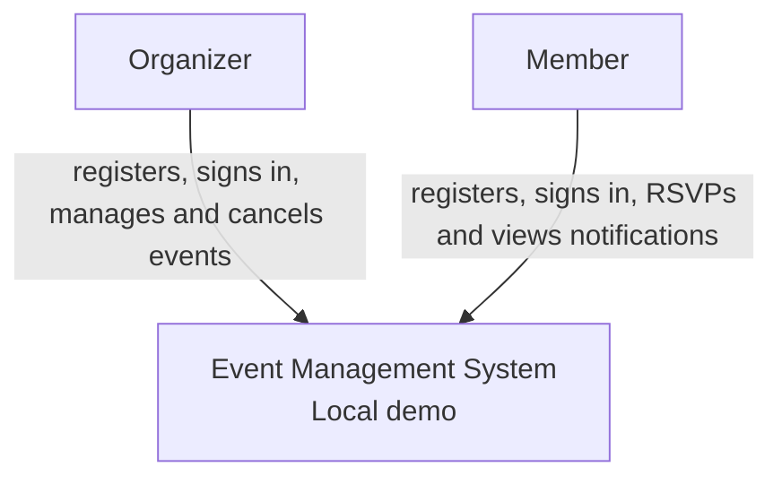
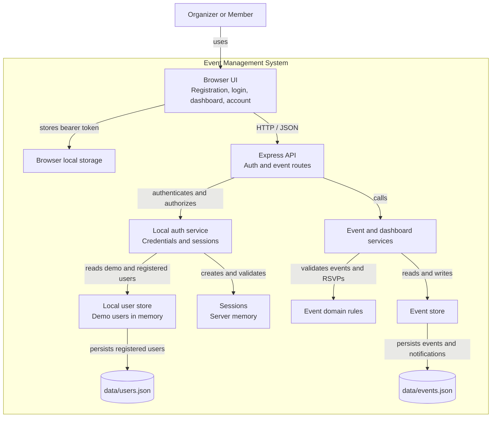
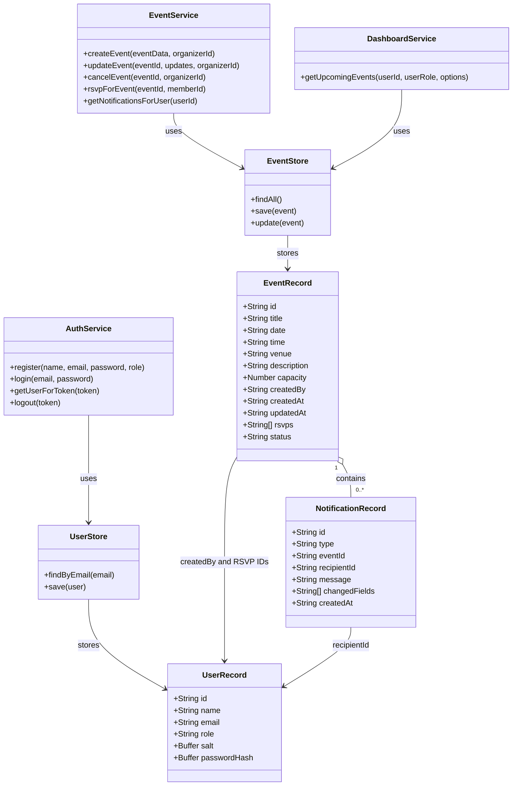
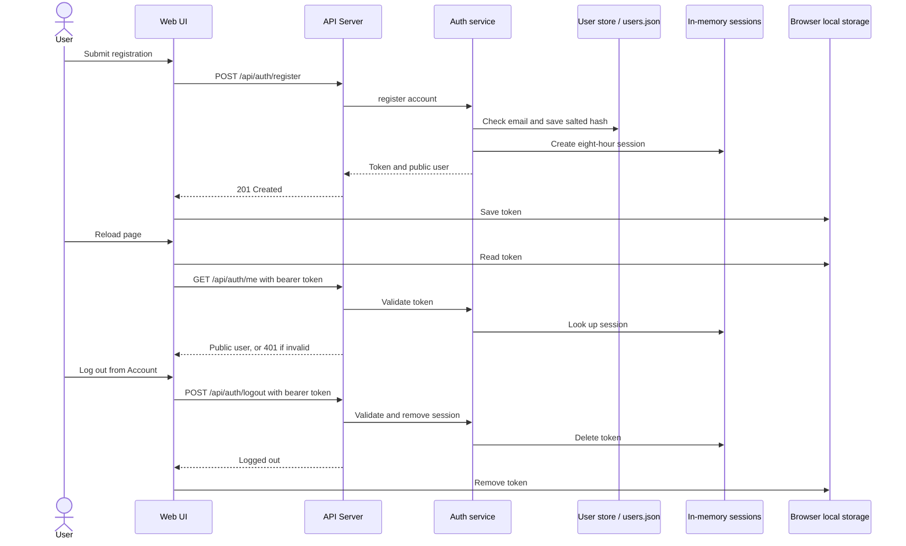
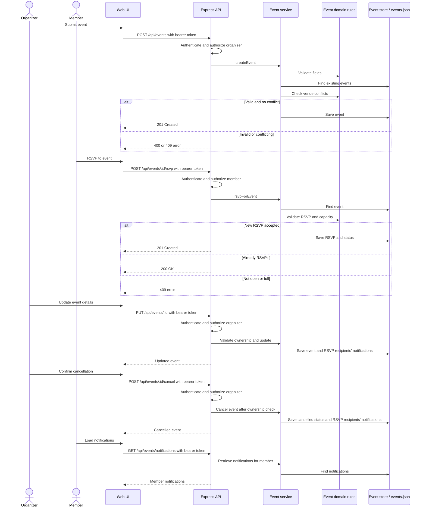

Event Management System


<!-- CI badge: after Session 4, replace ORG/REPO and the workflow filename, then uncomment:

-->

**Student:** [Jonathan Morency] · **Course:** CEN 5064 Software Design, Fall 2026 · **Partner:** [@cmend137]

## Project (approval paragraph — write this by Sun Aug 30)

Project Name: Event Management System
This is a web-based application is designed for university student organizations to create, organize, and RSVP 
events. It will centralize the event information through a dashboard where the user can view upcoming events, manage 
existing events and track attendance. This system will be for student organization administrators and members. 3 main 
features of the system would be 1, the homepage dashboard; 2, the event creation and management feature which will enforce
the business rules such as preventing overlapping event schedules and venues, as well as locking events when they reach full 
capacity; and 3, the event notification feature shown through an in-app banner that will notify organization administrators 
of any changes to the amount of members currently RSVP'd to an event, and notify organization members of any changes to 
the time and place of a venue they RSVP'd or if the event had been cancelled.

[One paragraph: What is the system? Who is it for? What are its 3–4 core features?
This paragraph is your approval request — see the Project Brief, Section 2.]

## How to run

Requires Node.js 18+ and npm.

```
git clone https://github.com/JMorency13/cen5064-project-morency.git
cd cen5064-project-morency
npm install
npm start
```

Open http://localhost:3000. To use a different port, set `PORT` first: `PORT=4000 npm start` (Mac/Linux), `$env:PORT=4000; npm start` (Windows PowerShell), or `set PORT=4000 && npm start` (Windows cmd). Events are saved to `data/events.json` (set `EVENTS_FILE` to change it) and survive restarts.

Run the tests with `npm test`.

### Organizer walkthrough

1. Select **Create account**, enter your details, choose **Organizer**, and submit the form. Alternatively, sign in with the [organizer demo account](#accounts-and-demo-limitations).
2. Under **Manage events**, enter a title, future date, start time, venue, and capacity. Add a description if you wish, then select **Create event**.
3. Find your event under **Upcoming events**. The capacity column shows how many members have RSVP'd. Events last one hour; an event that overlaps another at the same venue is rejected.
4. To change an event, select **Edit**, update its details, and select **Update event**. Members who RSVP'd receive a notification when details change.
5. To cancel an event, select **Cancel event** and confirm. Its status changes to `cancelled`, and members who RSVP'd receive a notification.
6. To sign out, select **Account**, then **Log out**.

### Member walkthrough

1. Select **Create account**, enter your details, choose **Member**, and submit the form. Alternatively, sign in with the [member demo account](#accounts-and-demo-limitations).
2. Browse **Upcoming events**. An organizer must first create an event for it to appear.
3. Select **RSVP** for an open event. The button changes to **RSVP’d**; events at capacity are marked `full` and cannot accept new RSVPs.
4. Check **Member notifications** for updates or cancellations to events you RSVP'd to. Notifications load when you sign in or reload; select **Load notifications** to refresh them. Cancelled events you RSVP'd to remain on your dashboard marked `cancelled`.
5. To sign out, select **Account**, then **Log out**.

## Architecture

### Tier breakdown (Session 2 studio)

| Tier | Responsibilities in THIS system |
|------|--------------------------------|
| Presentation | The browser registration and login forms and role-specific event dashboard in `public/index.html`. |
| Service | API orchestration, credential verification and session management, event creation/update/cancellation, RSVP, notifications, and dashboard queries. |
| Domain | Pure event validation, venue-conflict detection, and RSVP capacity/event-state rules. |
| Data | The event repository persists `data/events.json`; the local user store persists registered users' salted password hashes in `data/users.json` and keeps demo account hashes in memory. |

### C4 — Context & Container (Session 3 studio)

The context diagram shows the roles supported by the current local demo.



The container diagram shows the running application and its local storage. Sessions
are kept in server memory, while the browser stores the bearer token for reloads.



### UML — Class & Sequence (Session 3 studio)

The model below describes the in-memory data records and service modules; records
are plain objects, not `User` or `Event` classes. Roles are values on a user record.
An event's `updatedAt` and notifications are present after an update or
cancellation; notifications are created for RSVP'd members when details change
or the event is cancelled.



Registration creates a session immediately. On reload, the browser checks its
saved token; logging out invalidates it on the server.



Event updates and cancellations create notifications for members who RSVP'd.
Notifications load on sign-in or reload and can also be refreshed on demand; the
application does not send email or push updates.



## Accounts and demo limitations

You can create a local account with a unique email address and a password of 8–128 characters, or use these demo accounts:

| Role | Email | Password |
|------|-------|----------|
| Organizer | `organizer@example.edu` | `organizer-demo` |
| Member | `member@example.edu` | `member-demo` |

- Sessions survive browser reloads but expire after eight hours, on server restart, or on logout.
- Demo passwords can be overridden with `DEMO_ORGANIZER_PASSWORD` and `DEMO_MEMBER_PASSWORD`; both must be set if `NODE_ENV=production`.
- This is a local demo, not production authentication: anyone can choose the organizer role, tokens are stored in browser local storage, and there is no university SSO.

### How data is stored

The demo uses local JSON files instead of a database. The server loads them into memory when it starts and writes changes back as users register or events change:

- **Accounts:** `data/users.json` stores registered users' names, email addresses, roles, IDs, and salted password hashes—not plaintext passwords. The built-in demo accounts are kept in memory instead. Set `USERS_FILE` before starting the server to use a different file.
- **Events:** `data/events.json` stores event details, organizer IDs, RSVPs, statuses, and in-app notifications. Set `EVENTS_FILE` before starting the server to use a different file.
- **Sessions:** Active sessions are held in server memory; the browser saves the session token in local storage to restore the login after a reload. Server restarts clear sessions, but not saved accounts or events.

The `data/` directory is ignored by Git. Keep these files and any alternative storage paths private and out of version control. Use one server process per user file; the simple store does not coordinate writes between processes.

In future development, the JSON files could be replaced with a database that supports concurrent users, reliable updates, and backups. Account authentication could move to a university SSO provider, with secure server-managed sessions instead of browser-stored tokens. These are potential improvements, not features of the current demo.

## Architecture Decision Records

Decisions live in [`docs/adr/`](docs/adr/). Start with ADR-001 in Session 4.

| # | Decision | Status |
|---|----------|--------|
| [001](docs/adr/adr-001.md) | [What I am building and why] | [proposed] |

## Weekly log (optional but recommended)

A one-line note per week keeps your commit story readable:

- Week 1 (Aug 24): repo created, three ideas drafted
- Week 2 (Aug 31): ...

## Working on: Create an event as an organizer 1
